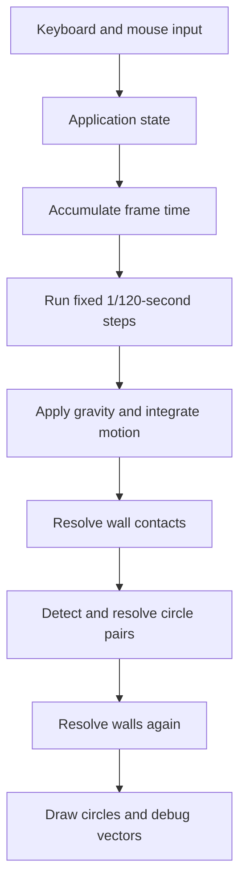

<div align="center">

# C++ Physics Playground

**Spawn circles. Toggle gravity. See collision response in motion.**

`C++17` · `raylib 5.5` · `Fixed-step physics` · `WebAssembly` · `CMake`

[Play live demo](https://kuvlay.github.io/cpp-physics-playground/) · [Controls](#controls) · [Desktop build](#desktop-build) · [How it works](#how-it-works) · [Browser build](#browser-build)

Maintained by [Kuvlay Naman](https://github.com/kuvlay)

</div>

---

An interactive 2D arena for exploring circle collisions, velocity and contact normals. The project implements collision detection and response in C++; raylib provides the window, input and drawing. The physics module is independent of rendering and can be checked without opening a window.

## At a glance

| Simulation | Interaction | Visualization |
| --- | --- | --- |
| Fixed 120 Hz physics timestep | Spawn circles with the mouse | Velocity arrows |
| Equal-mass elastic circle collisions | Toggle gravity and pause | Sampled contact normals |
| Radius-aware wall and corner bounces | Reset to a four-circle scene | Native window or WebAssembly canvas |

The arena supports up to **80 circles**. These are implementation settings, not measured performance guarantees.

## Controls

| Input | Action |
| --- | --- |
| Left click | Spawn a circle in free space inside the arena |
| `P` | Pause or resume the simulation |
| `R` | Reset the scene and settings |
| `G` | Toggle gravity |
| `C` | Toggle velocity arrows and contact normals |
| `Escape` | Close the desktop application |

Spawning works while paused. White arrows show velocity, and yellow arrows show contacts sampled during the most recent physics step. Close the browser tab to exit the web version.

## Desktop build

**Requirements:** C/C++ compiler with C++17 support, CMake 3.24+, Ninja and Git. CMake downloads the pinned raylib 5.5 dependency on first configuration.

```bash
git clone https://github.com/kuvlay/cpp-physics-playground.git
cd cpp-physics-playground
```

### Windows · PowerShell

With GCC/G++, CMake, Ninja and Git on `PATH`:

```powershell
cmake -S . -B build -G Ninja -DCMAKE_BUILD_TYPE=Debug -DCMAKE_C_COMPILER=gcc -DCMAKE_CXX_COMPILER=g++
cmake --build build
.\build\collision_playground.exe
```

Keep the MinGW runtime DLLs available on `PATH` and close the running application before rebuilding.

### Linux / WSL

Install [raylib's desktop graphics dependencies](https://github.com/raysan5/raylib/wiki/Working-on-GNU-Linux). WSL needs a graphical session such as WSLg.

```bash
cmake -S . -B build-linux -G Ninja -DCMAKE_BUILD_TYPE=Debug
cmake --build build-linux
./build-linux/collision_playground
```

Use separate build directories for different operating systems and compilers.

## How it works



Each body has position and velocity. All circles use a 25-pixel radius and implicit unit mass. Motion uses semi-implicit Euler integration. The application performs at most eight physics updates per rendered frame, then drops overdue whole steps to keep catch-up work bounded.

Circle pairs are tested with squared distance. Overlap correction separates the pair along its contact normal. When the pair is approaching, an impulse changes the normal velocity while preserving tangential motion. Restitution is 1 for isolated elastic collisions. The pair loop checks every unique pair and has **O(n²)** cost.

Rendering targets 60 FPS independently of the 120 Hz physics step. Contact arrows show only the most recent physics sample, so very brief contacts may not appear in a rendered frame.

## Browser build

The [live WebAssembly demo](https://kuvlay.github.io/cpp-physics-playground/) is hosted on GitHub Pages. The deployment and a gravity-toggle interaction have been verified in the browser.

Activate [Emscripten](https://emscripten.org/docs/getting_started/downloads.html) 3.1.74, then run from the repository root:

```bash
emcmake cmake -S . -B build-web -DPLATFORM=Web -DCMAKE_BUILD_TYPE=Release
cmake --build build-web --parallel 2
python3 -m http.server 8000 --directory build-web/site
```

Open **http://localhost:8000** with a keyboard and mouse. Serve the full `build-web/site` directory, including HTML, JavaScript and WebAssembly; opening the HTML file directly does not provide a working module server.

The browser uses the same physics code. Emscripten schedules `UpdateDrawFrame` through the browser event loop. The included GitHub Actions workflow runs physics checks, builds the WebAssembly output and deploys it when the repository's Pages source is configured as **GitHub Actions**.

## Physics checks

These checks do not depend on raylib or a graphical display:

```bash
mkdir -p build-checks
c++ -std=c++17 -O2 -Wall -Wextra -Wpedantic -Isrc \
  tests/physics_checks.cpp src/physics.cpp -o build-checks/physics_checks
./build-checks/physics_checks
```

The existing headless checks were compiled and run during this documentation update; they completed with `Stage 4 physics checks passed.` This verifies the physics assertions, not the desktop UI or browser deployment.

Coverage includes wall/corner bounces, head-on and glancing contacts, momentum and kinetic energy for isolated elastic pairs, separating overlaps, coincident centers, gravity and contact sampling. The stress checks use 80 circles over 7,200 steps with gravity off and on. Keep assertions enabled: the test source rejects `NDEBUG` builds.

## Code map

| File | Responsibility |
| --- | --- |
| `src/main.cpp` | Input, spawning, timestep accumulator and rendering |
| `src/physics.h` | Vector, body, arena and contact types |
| `src/physics.cpp` | Integration and collision response |
| `tests/physics_checks.cpp` | Standalone assertions and stress checks |
| `CMakeLists.txt` | Native/WebAssembly build and pinned raylib dependency |
| `web/shell.html` | Browser canvas and loading/error states |
| `.github/workflows/deploy-demo.yml` | Checks, browser build and Pages deployment |

## Current scope

Discrete detection can miss fast contacts between steps. A single contact pass can leave overlap or jitter in dense groups; stable stacking is not implemented. Circles share mass and radius, with no friction, rotation or damping. The project has no spatial partitioning or measured FPS dashboard.

<details>
<summary>Libraries and credits</summary>

[raylib](https://github.com/raysan5/raylib) supplies rendering and input; [Emscripten](https://emscripten.org/) supplies the WebAssembly toolchain. Existing development history and third-party notices are retained in their respective sources.

</details>
